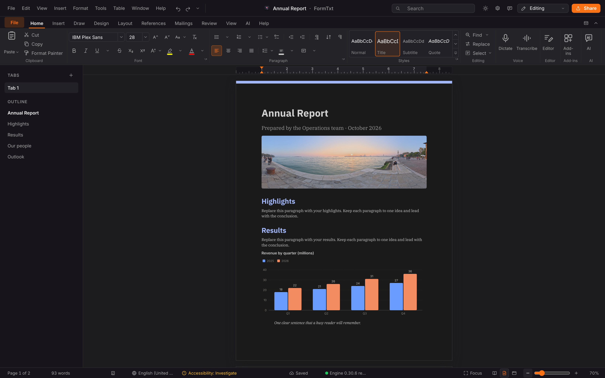
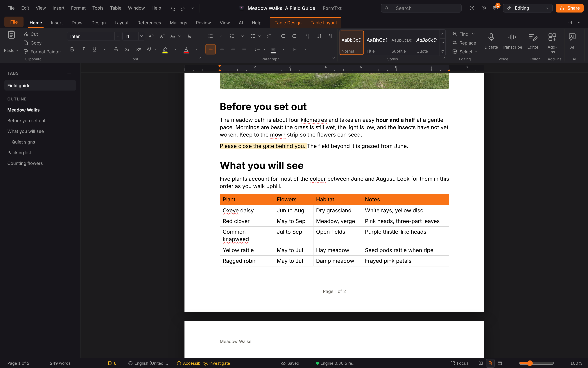
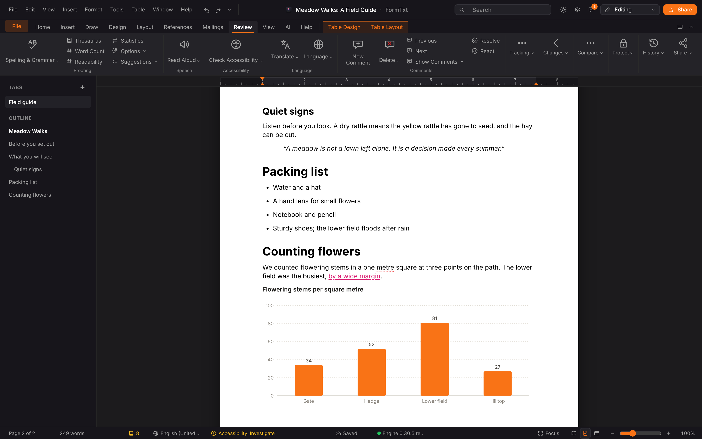
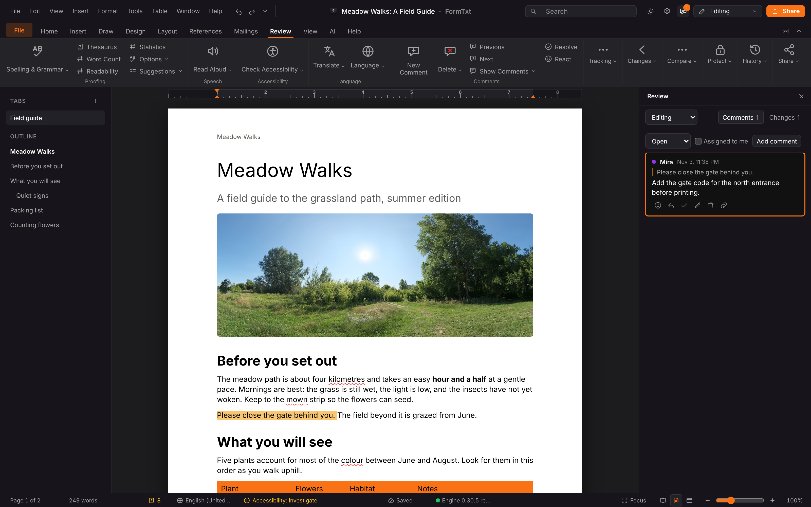

<p align="center">
  
</p>

<h1 align="center">FormTxt</h1>

<p align="center">
  <b>Word processing; the word processor of the Form family.</b><br>
  Real pages or pageless, a full ribbon, .docx and .odt round trips,<br>
  review, references and charts. Local-first, no account, and yours.
</p>

<p align="center">
  
  
  
  
  
  
</p>

<p align="center">
  <a href="https://formtxt.formai.studio/"><b>Download FormTxt on formai.studio</b></a> ·
  <a href="#run-it-from-source">Run it from source</a>
</p>

Version 0.30.8 · Apache-2.0 · macOS, Windows, Linux (browser, or the desktop app built with ./build_app)

<br>

<p align="center">
  
  <br>
  <sub>The Annual Report template with a photo and a chart added, shown with the Dark Page view option.</sub>
</p>

<p align="center">
  <a href="#features">Features</a> ·
  <a href="#everything-in-the-box">In the box</a> ·
  <a href="#built-for-agents">Agents</a> ·
  <a href="#under-the-hood">Under the hood</a> ·
  <a href="#download">Download</a> ·
  <a href="#run-it-from-source">Run from source</a>
</p>

<br>

<table>
  <tr>
    <td width="25%" valign="top"><h3>Real pages</h3>Paper size, margins, headers, footers, columns and sections lay out line by line, or switch to a pageless view.</td>
    <td width="25%" valign="top"><h3>Word compatible</h3>Open and save .docx, .dotx, .odt, .rtf, .html and Markdown, keeping comments and tracked changes.</td>
    <td width="25%" valign="top"><h3>Local-first</h3>Documents live in a folder on your computer. The engine listens on this machine only, and no account is needed.</td>
    <td width="25%" valign="top"><h3>Agent-ready</h3>Every editor command also runs from a terminal with <code>./formtxt cli</code>, the same commands a person uses.</td>
  </tr>
</table>

## Features

<table>
  <tr>
    <td width="50%" valign="top">
      
      <br><sub>A table with an accent header, banded rows and table tabs.</sub>
      <h3>Tables that behave</h3>
      Merge and split cells, repeat header rows across pages, sort, and use formulas such as <code>=SUM(ABOVE)</code>.
    </td>
    <td width="50%" valign="top">
      
      <br><sub>A chart, a list and a suggested edit on page two.</sub>
      <h3>Charts, diagrams and equations</h3>
      Insert charts with live data, IntelligentArt diagrams, Mermaid diagrams and LaTeX equations.
    </td>
  </tr>
  <tr>
    <td width="50%" valign="top">
      
      <br><sub>The Review pane with a comment thread on the page.</sub>
      <h3>Review with others</h3>
      Comments with replies and reactions, suggesting mode that tracks every edit, and compare and combine.
    </td>
    <td width="50%" valign="top">
      <h3>Ribbon and keyboard</h3>
      The ribbon has tabs, contextual tabs, Alt key tips and a command search (Alt+Q). Shortcuts follow Word and Google Docs and can be changed.
      <h3>References</h3>
      Tables of contents, footnotes, citations with a bibliography, captions, cross-references and an index.
    </td>
  </tr>
</table>

## Everything in the box

<table>
  <tr>
    <td width="33%" valign="top"><h4>39 templates in 11 categories</h4>Recent documents · Pin and duplicate · Trash with restore · Building blocks</td>
    <td width="33%" valign="top"><h4>13 chart types, 12 diagram layouts</h4>Column · Line · Doughnut · Gauge · Heat map · Process · Cycle · Venn</td>
    <td width="33%" valign="top"><h4>Formats</h4>Opens: .docx, .dotx, .odt, .rtf, .html, Markdown, .doc, PDF · Saves: .docx, .odt, .rtf, .html, Markdown, EPUB, PDF · Native: <code>.ftxt</code></td>
  </tr>
</table>

## Built for agents

The editor's commands live in one catalogue, and the window and the terminal call the same ones.

```sh
./formtxt cli list                                                  # the command catalogue
./formtxt cli describe tools.stats                                  # one command and its arguments
./formtxt cli run edit.replaceAll find=draft replace=final          # run a command in the open window
./formtxt mcp                                                       # MCP server on stdio for Claude Code, Codex and Cursor
./formtxt agents install                                            # register that server and the formtxt-driving skill for this user
```

The commands need the window open, and the first one an outside agent runs asks you once in the window. `.mcp.json`, `.codex/config.toml` and `.cursor/mcp.json` are already wired in this repo. See [`AGENTS.md`](AGENTS.md) and [`CLAUDE.md`](CLAUDE.md).

## Under the hood

- **Frontend:** vanilla TypeScript and Vite, with ProseMirror editing and its own page layout.
- **Engine:** Python and FastAPI own the `.ftxt` model, file exchange, proofing and exports.
- **Desktop:** a Tauri 2 shell around the same UI, with the engine frozen as a sidecar.
- **Format:** `.ftxt` is a zip of `document.json` and `media/`; the contract is [`docs/FORMAT.md`](docs/FORMAT.md).
- **Tested:** backend tests in `backend/tests` (library, exchange, versions, format, boot) and a window test in `frontend/tests/window`.

## Download

| Platform | Download | Release |
|---|---|---|
| macOS | [Download FormTxt for macOS](https://formai.studio/get/formtxt/macos) | [FormTxt releases on FormCompiler](https://github.com/nodemode-dev/formcompiler/releases?q=formtxt-v&expanded=true) |
| Windows | [Download FormTxt for Windows](https://formai.studio/get/formtxt/windows) | [FormTxt releases on FormCompiler](https://github.com/nodemode-dev/formcompiler/releases?q=formtxt-v&expanded=true) |
| Linux | [Download FormTxt for Linux](https://formai.studio/get/formtxt/linux) | [FormTxt releases on FormCompiler](https://github.com/nodemode-dev/formcompiler/releases?q=formtxt-v&expanded=true) |

All FormTxt builds are compiled and released from [FormCompiler](https://github.com/nodemode-dev/formcompiler); this repo holds the source.

## Run it from source

Prefer it in your browser, or want to contribute? Run the web UI straight from this repo.

**Requires:** Python 3.12 or newer and Node 20.19 or newer.

```sh
git clone git@github.com:nodemode-dev/formtxt.git
cd formtxt
./formtxt_oc_install      # backend venv and frontend packages
./formtxt                 # engine on 127.0.0.1:8210, web UI at http://localhost:5210
```

`./formtxt desktop dev` opens the desktop window instead, and `./build_app` builds the installable desktop app.

On Windows use `formtxt_oc_install.bat` then `formtxt.bat`. The engine listens on 127.0.0.1:8210 only; `FORMTXT_UI_PORT`, `FORMTXT_ENGINE_PORT` and `FORMTXT_DATA_DIR` (default `~/FormTxt`) override the ports and the library folder.

> [!IMPORTANT]
> **Status:** in development. Releases are not published yet, so run it from source or watch formai.studio. The planning roadmap lives outside this repo.

**Contributing:** branch from `main`, keep changes to source here, and leave packaging and releases to FormCompiler. See [`AGENTS.md`](AGENTS.md) and [`CLAUDE.md`](CLAUDE.md).

## Repository

`frontend/` is the web UI, `backend/` the FastAPI engine and its tests, `src-tauri/` the desktop shell, `setup/` the install, boot and build scripts, and `docs/` the format contract and images. Agents: [`CLAUDE.md`](CLAUDE.md), [`AGENTS.md`](AGENTS.md).

## Maintainers

| Maintainer | Role |
|---|---|
| [@nodemode-ai](https://github.com/nodemode-ai) | Owner |
| [@gbarnai](https://github.com/gbarnai) | Co-owner |

Code owners are set in [`.github/CODEOWNERS`](.github/CODEOWNERS).

## License

FormTxt is licensed under the Apache License 2.0 ([`LICENSE`](LICENSE), SPDX `Apache-2.0`). Copyright 2026 NodeAgentc, Inc. Third-party notices: [`NOTICE.md`](NOTICE.md).

<sub>Screenshot content: a CC0 photo from Poly Haven and an original sample document.</sub>

<sub>Microsoft, Word and Office are trademarks of the Microsoft group of companies. Google Docs is a trademark of Google LLC. FormTxt is not affiliated with or endorsed by Microsoft or Google; the names describe file formats, key sets and compatibility only. Claude Code, Codex and Cursor are trademarks of Anthropic, OpenAI and Anysphere respectively, named only as MCP clients FormTxt works with.</sub>
